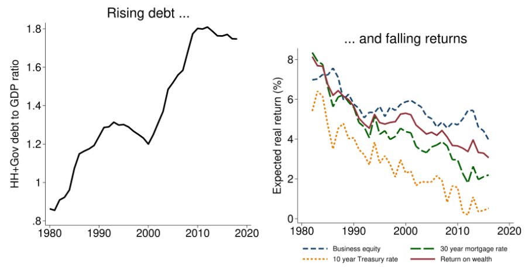
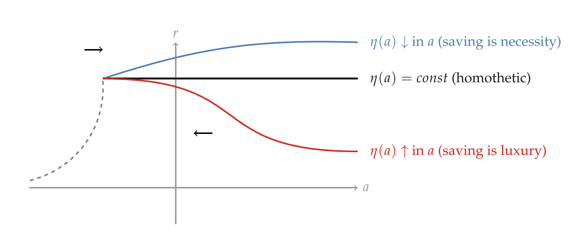
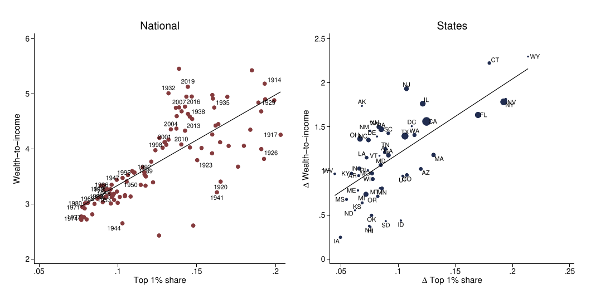

\hypersetup{linkcolor=black}
\renewcommand{\contentsname}{Innholdsfortegnelse}
\renewcommand*{\figureautorefname}{Figur}
\renewcommand*{\tableautorefname}{Tabell}
\renewcommand*{\equationautorefname}{Ligning}
\renewcommand*{\sectionautorefname}{Kapittel}
\renewcommand*{\subsectionautorefname}{Underkapittel}
\renewcommand*{\subsubsectionautorefname}{Delkapittel}
\renewcommand{\figurename}{Figur}
\setcounter{tocdepth}{2}
\tableofcontents
\hypersetup{linkcolor=blue}
\newpage
\thispagestyle{plain}
\begin{center}
    \Large
    \textbf{Sammendrag}
\end{center}

I *Indebted Demand* undersøker Mian, Straub og Sufi (2021) hvordan økt gjeld kan gå sammen med lavere realavkastning. Forfatterne utvikler en modell der låntakere bruker mer av en varig inntektsøkning på konsum enn sparere gjør. Når låntakerne betaler mer i renter, øker derfor sparernes konsum mindre enn låntakernes konsum faller. I modellen må den naturlige renten da ned for å opprettholde etterspørselen. Hvis renten møter en nedre grense, kan produksjonen bli liggende under kapasitet. Empiriske studier støtter deler av forklaringen, men verken observerte sammenhenger eller kalibrerte simuleringer fastslår hvor mye av det historiske rentefallet mekanismen forklarer.

\newpage

# Analyse av vitenskapelig artikkel

## Artikkelens innhold og metode

Siden 1980 har amerikansk husholdningsgjeld og offentlig gjeld samlet økt med nesten 100 prosentpoeng av BNP. I samme periode falt forventet realavkastning på flere typer aktiva med 3–5 prosentpoeng. Utviklingen motiverer forskningsspørsmålene, men viser ikke hvilken vei årsakssammenhengen går.

{width=100%}

Med *indebted demand* mener forfatterne etterspørsel som tynges av gjeldsbetjening. Skillet går mellom tidspunktet da lånet finansierer konsum, og perioden etterpå, da låntakeren må sette av inntekt til betalingene.

## Hvilke spørsmål forsøkte artikkelen å svare på?

@mian2021indebted stiller to hovedspørsmål: Hvordan oppsto kombinasjonen av høy gjeld og lav avkastning? Hvilke konsekvenser har denne kombinasjonen for den økonomiske utviklingen og utformingen av makroøkonomisk politikk? For å besvare spørsmålene undersøker forfatterne blant annet hvilken rolle økt inntektsulikhet og lettere kredittilgang kan ha spilt, og hvordan gjeldsoppbygging påvirker handlingsrommet for økonomisk politikk.

## Hvilke metoder brukte artikkelen for å svare på spørsmålet?

Forfatterne bygger en deterministisk modell med to husholdningstyper, sparere og låntakere, innenfor et rammeverk med generasjonsskifte og arv. I grunnmodellen eier husholdningene såkalte Lucas-trær: eiendeler som gir en fast mengde av konsumvaren i hver periode. Forfatterne utleder likevekter og overgangsforløp, sammenligner med en homotetisk[^1] referansemodell og utvider analysen med offentlig sektor, nominelle rigiditeter[^2] og investeringer [@mian2021indebted].

[^1]: Homotetiske preferanser betyr at når en husholdnings ressurser øker, endres ikke fordelingen mellom ulike formål så lenge de relative prisene er uendret. I artikkelens referansemodell betyr det at husholdningen bruker samme andel på konsum og sparer samme andel som før.

[^2]: Nominelle rigiditeter betyr at priser eller lønninger tilpasser seg gradvis når økonomiske forhold endrer seg. For eksempel kan lønnen være fastsatt i en avtale og derfor forbli uendret fram til neste lønnsoppgjør.

Forfatterne bruker empiriske resultater til å velge modellparametere. Deretter simulerer de hvordan gjeld og renter reagerer på økt ulikhet.

# Påstander og begrunnelse

## Hva er det sentrale nye bidraget

Artikkelens bidrag er å knytte forskjeller i sparing fra **permanent inntekt** til den naturlige renten, altså realrenten som er forenlig med produksjon ved full kapasitet. Det avgjørende er hvordan husholdningene bruker en varig endring i kjøpekraft.

Mekanismen kan illustreres enkelt. La en varig økning i gjeldsbetjeningen på $x$ kroner overføre inntekt fra låntakere til sparere. Hvis deres marginale konsumtilbøyeligheter er henholdsvis $m_b$ og $m_s$ blir den direkte konsumvirkningen ved uendret rente:

$$
\Delta C = (m_s - m_b) x < 0
$$

når $m_b > m_s$.

Uttrykket illustrerer den direkte fordelingseffekten ved samme tidshorisont for begge grupper.

Inntekten som låntakeren mister, tilfaller spareren. Når spareren bare bruker en del av denne inntekten, faller samlet konsum ved uendret rente. I grunnmodellen er produksjonen gitt; renten må derfor falle for at varemarkedet skal klareres [@mian2021indebted, s. 2259–2260].

Herfra følger to sentrale resultater under modellens forutsetninger. En større inntektsandel til sparerne senker den langsiktige renten og øker husholdningsgjelden. Lettere kredittilgang kan også gi mer gjeld og lavere langsiktig rente fordi den senere gjeldsbetjeningen styrker overføringen til sparerne [@mian2021indebted, proposisjon 4–5].

## Ble noen hypoteser satt opp og avkreftet?

{width=100%}

Forfatterne tester ingen statistisk nullhypotese. Figur 2 sammenligner i stedet modellenes prediksjoner: For hvert formuesnivå viser kurven hvilken rente som gjør det optimalt for spareren å holde formuen konstant. Den svarte linjen er vannrett fordi denne renten er uavhengig av formuen i den homotetiske referansemodellen. I hovedmodellen ønsker mer formuende sparere å spare en større andel av en varig inntektsøkning. Renten som gjør dem tilfreds med uendret formue, må dermed være lavere. Det er derfor den røde kurven heller nedover [@mian2021indebted, s. 2256–2258].

## Hvordan begrunnes rimeligheten av antakelsene

Studier av livsinntekt tyder på at husholdninger med høy inntekt sparer en større andel gjennom livet. Forfatterne viser også til at formuende husholdninger øker konsumet lite når formuen stiger. Begge funn støtter antakelsen, men måler ulike størrelser: Hvor mye en husholdning i gjennomsnitt sparer, forteller ikke direkte hvor mye den vil bruke av én ekstra krone i varig inntekt [@mian2021indebted, del IV, s. 2265–2270].

# Relevans

## Vitenskapelig og samfunnsmessig relevans

To tiltak som øker etterspørselen like mye i dag, kan ha ulike virkninger senere. Et nytt lån må betjenes av låntakeren, mens en overføring kan styrke den samme husholdningens kjøpekraft uten å øke gjelden.

### Pengepolitikk har flere kanaler

Et rentekutt kan øke både sparernes konsum og låntakernes gjeldsfinansierte konsum. Proposisjon 7 viser at det er stimulansen gjennom ny gjeld som motsvares av svakere etterspørsel senere, når gjelden må betjenes [@mian2021indebted, s. 2284–2285].

### Offentlig gjeld avhenger av finansieringen

Den langsiktige virkningen av offentlig gjeld avhenger av hvem som til slutt bærer skattene eller utgiftskuttene som finansierer gjeldsbetjeningen. Artikkelen diskuterer også særskilt avkastning på statsobligasjoner og mulige unntak når statsrenten ligger tilstrekkelig under vekstraten. Konklusjonen kan derfor ikke være at alle offentlige underskudd nødvendigvis svekker fremtidig etterspørsel. 

### Gjeldsfellen krever en bindende nedre grense

Når den naturlige renten ligger under den effektive nedre grensen, kan renten ikke justeres nok til å opprettholde full sysselsetting. Med nominelle rigiditeter kan økonomien da ha en stabil likevekt med produksjon under kapasitet. Dette er et betinget resultat, ikke en påstand om at enhver gjeldsøkning ender i en krise.

Grensen i modellen gjelder den relevante realavkastningen og trenger derfor ikke være null, selv om den nominelle styringsrenten er null [@mian2021indebted, s. 2287–2288].

### Omfordeling og gjeldslette

I modellens gjeldsfelle kan omfordeling øke produksjonen og være Pareto-forbedrende[^3]. Det er et velferdsresultat innenfor den spesifiserte modellen, ikke et generelt bevis for at enhver skatteøkning gjør alle bedre stilt. En engangs gjeldslette gir heller ingen varig endring i likevekten uten endringer i fordeling eller kredittbetingelser [@mian2021indebted, proposisjon 10–11].

[^3]: Pareto-forbedring betyr at minst én person får det bedre uten at noen andre får det verre.

# Hva videre forskning tilfører

## Hvilke spørsmål er fulgt opp

De fire studiene følger opp ulike spørsmål om finanspolitikk, boligformue, preferanser og kriser.

### Kan staten finansiere varige underskudd uten senere skatteøkninger

@mian2025goldilocks viser at en statsrente under vekstraten ikke alene sikrer at varige underskudd kan finansieres uten senere skatteøkninger: Renten kan stige når gjelden øker. Ved den nominelle nullgrensen kan også for små underskudd øke gjelden relativt til BNP ved å svekke etterspørselen og den nominelle veksten.

### Hvem lånte mer og hvilken rolle spilte boligformue

@bartscher2025distribution finner at nesten halvparten av veksten i amerikansk husholdningsgjeld etter 1980 kom fra økt belåning av boligformue. Dermed må en forklaring på hvem som lånte mer, ta hensyn til hvilke boligeiere som fikk mer sikkerhet å låne mot da boligprisene steg.

### Kreves ikke-homotetiske preferanser

@brault2021carleton viser at mer ulikhet kan gi mer gjeld og svakere fremtidig etterspørsel også i en modell med to perioder og homotetiske preferanser. Her får låntakerne låne mer når ulikheten øker; lignende resultater kan altså oppstå gjennom andre forutsetninger om kreditt og sparing.

### Er selskapsgjeld og husholdningsgjeld samme problem

@ivashina2025corporate finner at vekst i selskapsgjeld særlig varsler finanskriser og svak investering, mens husholdningsgjeld også henger sammen med svakere vekst uten krise. Skillet er viktig fordi fall i investeringene etter bedriftsmislighold og fall i konsumet ved gjeldsbetjening er forskjellige mekanismer.

# Empirisk grunnlag og teoretisk analyse

## Hvilke data brukes og hvordan analyseres de

{width=100%}

Figur 3 viser at en høyere inntektsandel for den øverste prosenten samvarierer med høyere formue relativt til inntekt. Venstre panel viser amerikanske observasjoner fra 1913 til 2019. Høyre panel sammenligner endringer i de to størrelsene mellom 1982 og 2007 på tvers av delstatene. Delstatssammenligningen viser at mønsteret også finnes innenfor samme land og periode, men utelukker ikke at for eksempel boligprisvekst påvirker begge størrelsene [@mian2021indebted, s. 2268–2269].

Forfatterne kalibrerer grunnmodellen til amerikanske forhold rundt 1980. Blant målene er husholdningsgjeld på 45 prosent av BNP og en vekstjustert realavkastning på 5,5 prosent. Studier av konsumresponsen på formue gir grunnlag for å sette sparernes marginale konsumtilbøyelighet fra formue til 0,01 [@mian2021indebted, s. 2263–2264].

I den utvidede modellen gir økt ulikhet et langsiktig rentefall på om lag tre prosentpoeng og en økning i husholdningsgjeld på rundt 80 prosentpoeng av BNP. Til sammenligning økte den observerte gjeldsgraden med om lag 55 prosentpoeng fra 1980 til finanskrisen. Modellen beregner forskjellen mellom to langsiktige likevekter, mens dataene dekker en avgrenset periode. Tallene gir derfor en sammenligning av størrelsesorden [@mian2021indebted, s. 2299–2301].

## Hvilke empiriske og kvantitative valg er viktigst

Teorien gjelder **permanent inntekt**, men figur 3 bruker toppgruppens andel av årets inntekt fordi tilsvarende tall for livsinntekt mangler. Hvis en bonus løfter en husholdning inn i toppgruppen bare ett år, endres den målte andelen uten at husholdningens varige ressurser øker tilsvarende. Forfatterne støtter valget på tidligere forskning som knytter økende årsinntektsulikhet til økende ulikhet i livsinntekt [@mian2021indebted, s. 2268].

I kalibreringen representerer sparerne den øverste prosenten av husholdningene. Det retter oppmerksomheten mot gruppen som eier mye formue, men skjuler forskjeller i likviditet og gjeld innenfor gruppen.

Forfatterne velger preferanseparametere slik at modellen treffer sparernes observerte konsumrespons på formue. Treffer modellen dette målet, er det følgelig ikke en uavhengig test. Gjeldsutviklingen i simuleringen gir mer informasjon om hvordan modellen fungerer utover kalibreringsmålene.

## Hvordan kunne andre valg endret arbeidet

En inndeling etter likvide midler og gjeldsbetjening kunne gitt en annen beregnet konsumrespons. En boligeier kan ha høy nettoformue, men lite penger tilgjengelig til løpende utgifter. Det er derfor ikke opplagt at inntektsgruppen alene viser hvem som må kutte konsumet når betalingene øker.

Forfatterne undersøker også et alternativ til perfekt forutseenhet: Husholdningene antar at dagens ulikhet vil bestå, framfor å forutse videre økning. Da forsvinner den første renteoppgangen i simuleringen, mens renten og gjelden på lang sikt blir de samme. Forventningsantakelsen betyr her mer for veien til den nye likevekten enn for selve sluttpunktet [@mian2021indebted, s. 2299–2300].

## Hva beviser forfatterne og hvordan

Bevisførselen tar utgangspunkt i husholdningenes nyttemaksimering, budsjettbetingelser og lånebegrensning. Forfatterne utleder sparerens Euler-ligning, som beskriver avveiningen mellom konsum nå og senere. I en stasjonær likevekt er formuen konstant, slik at sparerens budsjettbetingelse kan skrives $c^s = ra^s$. Når denne settes inn i Euler-ligningen, får de følgende langsiktige sammenheng [@mian2021indebted, ligning (9), s. 2256–2257]:

$$
r(a^s)=\rho\frac{1+\delta/\rho}{1+(\delta/\rho)\eta(a^s)}
$$

Her er $a^s$ sparernes formue, $\rho$ diskonteringsraten, $\delta$ dødsraten og $\eta(a^s)$ funksjonen som beskriver styrken på arvemotivet relativt til den homotetiske referansen. Når $\eta'(a^s)>0$, øker nevneren med formuen. Dermed faller renten som er forenlig med konstant formue. Dette er kjernen i proposisjon 1 om en nedadgående langsiktig sparekurve.

Denne betingelsen kombineres med låntakernes langsiktige gjeldsetterspørsel, $d=\ell/r$, der $\ell$ bestemmer lånekapasiteten. Proposisjon 2 karakteriserer likevekten. Deretter viser proposisjon 3 at en liten, permanent overføring fra låntakere til sparere reduserer samlet konsum på virkningstidspunktet når renten holdes fast og den relevante ikke-homotetisiteten er positiv. Låntakerens konsum faller én til én med betalingen, mens sparerens konsum øker mindre. I generell likevekt må renten derfor tilpasses for å gjenopprette balanse [@mian2021indebted, s. 2258–2260].

## Hvilke antakelser bygger resultatene på

**Ikke-homotetiske preferanser.** Den sentrale antakelsen er at sparernes sparetilbøyelighet fra permanent inntekt er høyere enn låntakernes. I modellen knyttes dette til at $\eta(a)$ øker med formuen. Det betyr ikke at marginalnytten av arv isolert sett må øke, den kan avta langsommere enn i den homotetiske referansen. Uten denne egenskapen får ikke grunnmodellen den samme langsiktige fordelingskanalen [@mian2021indebted, s. 2251 og 2257–2260].

**Husholdninger og kreditt.** Formuen går i arv innenfor hvert av to dynastier, og låntakernes tilgang på kreditt avhenger av hva de kan stille som sikkerhet. Dette gjør det mulig å følge betalingene mellom gruppene, men utelater sosial mobilitet og en eksplisitt banksektor.

**Produksjon og forventninger.** Gitt produksjon og perfekt forutseenhet i grunnmodellen isolerer rentevirkningen. Forfatterne åpner senere for investeringer og undersøker hvordan andre forventninger påvirker overgangen mellom likevekter.

**Gjeldsfellen.** En lavere naturlig rente er mulig uten produksjonstap. For resultatet om vedvarende produksjon under kapasitet må derimot nominelle rigiditeter og en bindende nedre rentegrense hindre den nødvendige tilpasningen [@mian2021indebted, del VII].

## Hvorfor kan teorien gi innsikt når antakelsene ikke er fullt oppfylt

Fordelingskanalen kan være virksom også med mange husholdningstyper. Det avgjørende er om de som betaler mer i renter, samlet reduserer konsumet mer enn mottakerne øker sitt. Denne forskjellen kan i prinsippet undersøkes ved å følge begge gruppenes konsum når gjeldsbetalingene endres.

Produktiv gjeld viser samtidig hvorfor virkningen kan skifte fortegn. Et lån til en ny maskin kan øke produksjonen og skape inntekter som et forbrukslån ikke gir. I proposisjon 13 kan den umiddelbare konsumvirkningen da være positiv. For å bruke teorien utenfor grunnmodellen må man derfor undersøke både hvem som mottar betalingene, og hva lånet finansierer [@mian2021indebted, s. 2294–2295].

# Konklusjon

Artikkelens sterkeste bidrag er å vise hvorfor fordelingen av gjeldsbetalinger kan ha betydning selv om det én husholdning betaler, blir inntekt for en annen. Mekanismen gir en sammenhengende forklaring på høyere gjeld og lavere renter. Hvor mye den forklarer historisk, er mer usikkert: Simuleringen gir en større gjeldsøkning enn den observerte, og dataene viser ikke hvordan begge sider av samme betaling endrer konsumet. Slike målinger ville gitt et bedre grunnlag for å vurdere mekanismens betydning.

\clearpage

# Referanser {.unnumbered}

::: {#refs}
:::

\clearpage

# Vedlegg om bruk av KI {.unnumbered}

I arbeidet med denne teksten er ChatGPT Astra brukt til å utarbeide et forslag til sammendrag, fylle ut spørsmål om empirisk grunnlag og teoretisk metode, omorganisere avslutningen og rette språk og referanser. KI-bearbeidingen erstatter ikke studentens egen faglige vurdering og kildekontroll før innlevering.
